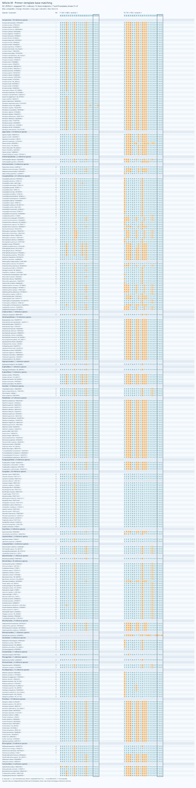
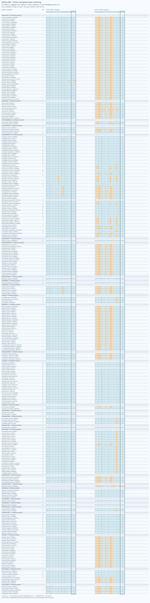

# MiScle

[中文](README.zh-CN.md)

**MiScle, a set of PCR primer candidates for metabarcoding environmental DNA from scleractinian corals**

## Abstract

MiScle compares two complementary mitochondrial 16S windows. Each window retains an ordinary A/C/G/T pair inspired by the alignment and conserved-anchor strategy of MiFish and a degenerate D pair inspired by the variation-compensation strategy of Anth-28S-eDNA. Ordinary and D primers share exactly the same reference endpoints. These are newly designed computational candidates, not the published MiFish or Anth28S sequences.

Among 305 species evaluable at one or both windows, the predicted detection union is 277/305 (90.82%) for the two ordinary pairs and 279/305 (91.48%) for the two D pairs. Exact paired matches increase from 65/305 (21.31%) to 206/305 (67.54%). All four pairs have zero strict WC and GT paired hits in 9,145 background records. These union statistics describe separate PCR assays followed by taxon-level aggregation; same-tube multiplexing has not been evaluated.

## Primers

Sequences are the target-specific portions, written 5′→3′ without adapters. S and M label homologous reference windows; actual product lengths vary among lineages. D denotes degeneracy.

| Pair | Forward, 5′→3′ | Reverse, 5′→3′ | F/R degeneracy |
|---|---|---|---:|
| MiScle-S | `TTTGATAAGTGGGACAGTTTGG` | `TTAACGGGTCACTTAAACCC` | 1 / 1 |
| MiScle-SD | `YTKGATAAGTGRGACAGTTTGG` | `YYAACGGGTCACTTWAACCC` | 8 / 8 |
| MiScle-M | `AAGTCCCTATGGAGCTTTAC` | `CCATAGTTCATTTTCGTTAC` | 1 / 1 |
| MiScle-MD | `AAGWCCCYATGGARCTTTAC` | `YCATAGYTCRTTTTCGTTAC` | 8 / 8 |

Y=C/T; K=G/T; R=A/G; W=A/T. Each D oligo represents eight concrete sequences, giving up to 64 F×R combinations per pair. Supported ambiguity is allowed throughout the oligo; the earlier projects' restriction to the 3′ half was not applied to this design.

[Primer table](primer_pairs.csv) · [FASTA](primers.fasta) · [Parameters](selected.json)

## Methods

### Reference compilation

Hisata et al. (2025) developed a **12S** assay. Here, annotated mitochondrial 16S sequences were extracted from eligible accessions in their Table 1, then supplemented with public Scleractinia records to include reef-building, non-reef and deep-water taxa. Of 110 audited paper accessions, 65 contained eligible 16S and 45 did not; the latter were excluded rather than counted as primer failures.

A target query returned 1,974 records. Combined curation retained 879 eligible 16S records. One representative per source taxid and binomial species label was selected using gene completeness, length and ambiguity, without selecting for primer compatibility. The panel contains 307 species labels, 131 genera and 29 source family labels. Source taxonomy has not undergone a complete synonym and family revision, so these are not asserted to be 29 currently accepted families. Only annotated 16S/large-subunit mitochondrial rRNA features were extracted, with feature orientation preserved. Records shorter than 150 nt or with more than 5% ambiguous bases were excluded.

MAFFT was used for alignment (Katoh & Standley, 2013). Coordinates refer to the extracted, ungapped 16S gene of *Acropora tenuis*, NC_003522.1, rather than whole-mitogenome positions. Window S is F1696–1717/R1826–1845, with a 150-bp reference span; window M is F1561–1580/R1741–1760, with a 200-bp span. Lineage-specific indels produce actual predicted primer-inclusive products of 147–209 bp and 99–186 bp, respectively.

### Candidate generation and selection

Conserved anchors were searched across reference spans of 150–250, 251–350 and 351–500 bp. The first pass examined 8,863 pairs; a complementary search examined another 5,582 pairs against taxa missed by the first window. Ranking considered species coverage, source-family representation and paired background amplification. This was a heuristic search, not an exhaustive guarantee of global optimality.

Ordinary candidates were derived from lineage consensus, observed templates and limited concrete sequence combinations, using only A/C/G/T. Degenerate candidates incorporated variation observed in homologous target columns, with a maximum degeneracy of eight per oligo, following the variation-compensation principle of Anth-28S-eDNA (McCartin et al., 2024). Within each selected window, ordinary pairs were ranked independently by coverage and then exact matching, rather than generated by simply removing ambiguity characters. MiFish informs the alignment, conserved-anchor and lineage-complementarity approach (Miya et al., 2015); its fish 12S specificity does not transfer automatically to coral 16S.

Primer3 calculations used 50 mM monovalent salt, 1.5 mM Mg²⁺ and 0.6 mM dNTP, comparing 50 nM per concrete variant with 200 nM total per direction (Untergasser et al., 2012). At 200 nM total, an eightfold oligo has 25 nM per variant. All concrete variants and within-pair homo/hetero interactions were checked. Maximum structure Tm was required to remain below 55°C and the difference between F/R duplex-Tm interval midpoints below 5°C. The final three positions must include a definite G/C base; candidates capable of forming five-base homopolymers were excluded. Terminal triplets were not an absolute exclusion criterion. Maximum predicted structure Tm ranges from 42.9 to 52.5°C. Adapter-bearing oligos and cross-window multiplex interactions were not assessed.

### Coverage, background and verification

The frozen background contains 1,938 cnidarian records collected from stratified Octocorallia, Antipatharia, Zoantharia, Corallimorpharia, Actiniaria and Hydrozoa searches, plus 7,207 echinoderm records. Query caps were applied; this is neither exhaustive cnidarian sampling nor systematic coverage of bacteria, symbiotic algae or all marine biota.

Coverage allows at most two mismatches per primer, with IUPAC-compatible final three bases. Exact matching requires zero mismatches at both ends. Raw-sequence scans examine both orientations, target products of 70–500 bp with at least 20 internal bases, and background internal distances of 0–1,000 bp. Strict WC and GT models retain the terminal constraint; GT permits G–T pairing computationally. WC3, GT2 and WC4 are relaxed sensitivity screens, not predictions of laboratory amplification probabilities.

Evaluability is based on sequence span and unambiguous information at homologous windows; internal indels alone are not treated as missing data. Each window has 304 evaluable species, 305 are evaluable at either window, and 303 at both. *Heterocyathus aequicostatus* and *Cycloseris distorta* lack sufficient window information and are not counted as missed detections.

Independent C++ exhaustive paired scans and Python bit-parallel scans agree on all 24 target-coverage, exact-match and strict-background set comparisons. Design and evaluation reuse the reference panel; no held-out or wet-laboratory validation has been performed.

## Results

| Pair | Evaluable species | Covered | Exact paired matches | Strict WC / GT | Relaxed WC3 / GT2 / WC4 |
|---|---:|---:|---:|---:|---:|
| MiScle-S | 304 | 153 (50.33%) | 64 (21.05%) | 0 / 0 | 0 / 0 / 0 |
| MiScle-SD | 304 | 155 (50.99%) | 125 (41.12%) | 0 / 0 | 6 / 0 / 211 |
| MiScle-M | 304 | 124 (40.79%) | 1 (0.33%) | 0 / 0 | 0 / 0 / 4 |
| MiScle-MD | 304 | 124 (40.79%) | 81 (26.64%) | 0 / 0 | 4 / 4 / 5 |
| Ordinary two-assay union | 305 | 277 (90.82%) | 65 (21.31%) | 0 / 0 | See individual pairs |
| D two-assay union | 305 | 279 (91.48%) | 206 (67.54%) | 0 / 0 | See individual pairs |

On the same 303-species common panel, ordinary and D unions cover 277 and 279 species and exactly match 65 and 206, respectively. The improvement is therefore not a denominator effect. The 211 WC4 background hits of MiScle-SD indicate residual cross-amplification sensitivity despite zero strict hits.

The D union misses 26 evaluable species: 14 source-labelled Caryophylliidae, all four Micrabaciidae representatives, two Anthemiphylliidae, two Acroporidae and one each from Agariciidae, Dendrophylliidae, Montastraeidae and Pocilloporidae. These candidates do not yet provide complete Scleractinia coverage.

[Per-species results](by_species.csv) · [Family/genus results](by_taxon.csv) · [Combined assays](two_pair_comparison.csv) · [Missed species](missed_species.csv) · [Unevaluable species](unknown_species.csv)

## Barcode resolution and base matching

Among covered reference species, only 25/153, 27/155, 26/124 and 26/124 have an internal barcode not shared identically with another covered species for MiScle-S, SD, M and MD, respectively. Cross-genus sharing also occurs. These are observations within the frozen library, not identification-success estimates. Classify each window separately and aggregate taxonomic detections; unlinked eDNA amplicons cannot be treated as phased multilocus haplotypes.

Both ends below are shown in primer synthesis orientation, 5′→3′; R templates are reverse-complemented. E denotes exact paired matching, C predicted coverage with allowed mismatches, – no predicted hit and ? insufficient reference information. Covered rows use independently verified raw-sequence templates; other rows show homologous reference columns. Open individual SVG files to inspect all species.

[Resolution](barcode_resolution.csv) · [Shared barcodes](shared_barcodes.csv) · [Verified templates and products](verified_templates.csv)

## Reproduction and files

- Run `python3 scripts/check_release.py` for release consistency checks.
- Run `python3 scripts/verify.py` to independently rescan frozen target and background sequences using Python's standard library; no network access is needed.
- [Verification summary](verification.json) · [Individual comparisons](independent_checks.csv) · [Paper-accession audit](data/paper_accession_audit.csv) · [Reference panel](data/panel.csv) · [Input manifest](manifest.json).
- Other design scripts retain workspace-specific paths and are supplied as analysis provenance, rather than a portable end-to-end design pipeline. C++ scan source is also included.
- `SHA256SUMS` records the final release files.

Priority experimental comparisons are parallel ordinary/D assays using tissue DNA from major reef lineages and missed deep-water groups, followed by mixed-template controls containing close non-targets and real eDNA samples. The present evidence favours testing D candidates, while species-level identification will require comparison with longer 16S regions or additional markers.

## References

1. Hisata, K., Nagata, T., Kanai, M., et al. (2025). An eDNA metabarcoding system for detecting scleractinian corals to the generic level along the Japanese coast. *Galaxea, Journal of Coral Reef Studies*, 27, 13–29. https://doi.org/10.3755/galaxea.G27D-5
2. Miya, M., Sato, Y., Fukunaga, T., et al. (2015). MiFish, a set of universal PCR primers for metabarcoding environmental DNA from fishes: detection of more than 230 subtropical marine species. *Royal Society Open Science*, 2, 150088. https://doi.org/10.1098/rsos.150088
3. McCartin, L., Saso, E., Vohsen, S. A., et al. (2024). Nuclear eDNA metabarcoding primers for anthozoan coral biodiversity assessment. *PeerJ*, 12, e18607. https://doi.org/10.7717/peerj.18607
4. Katoh, K., & Standley, D. M. (2013). MAFFT multiple sequence alignment software version 7: improvements in performance and usability. *Molecular Biology and Evolution*, 30, 772–780. https://doi.org/10.1093/molbev/mst010
5. Untergasser, A., Cutcutache, I., Koressaar, T., et al. (2012). Primer3—new capabilities and interfaces. *Nucleic Acids Research*, 40, e115. https://doi.org/10.1093/nar/gks596

## Copyright

Copyright © 2026 Fei Xia (GUIBA-EX). All rights reserved. Republication and redistribution of protected original materials require prior written permission. Public database records retain their existing rights and conditions. See [Copyright and permissions](COPYRIGHT.md).
