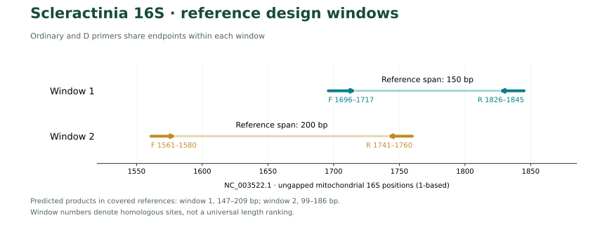
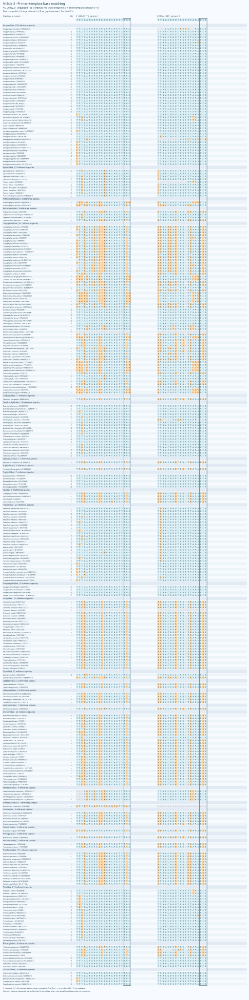
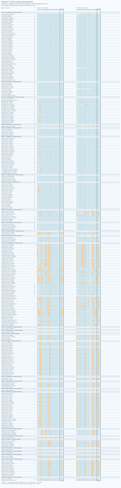
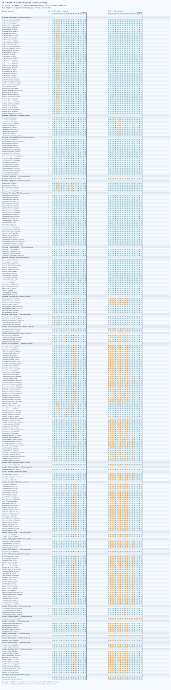
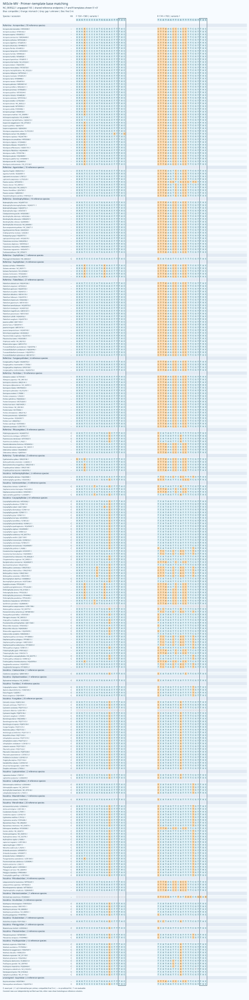
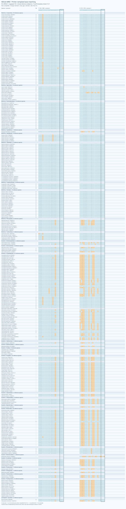
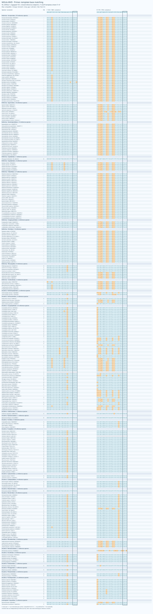

# MiScle

[English](README.md)

**MiScle, a set of PCR primer candidates for metabarcoding environmental DNA from scleractinian corals**

## 摘要

MiScle比较石珊瑚线粒体16S的S、M两个同源窗口。S保留普通与D引物；M分别为Refertina和Vacatina优化F/R，保留MR、MV、MRD、MVD。R/V表示设计侧重的亚目，D表示含简并；对应普通与D端点一致，每条简并度≤8。两个亚目均为目标，允许交叉覆盖。

本轮重点恢复Vacatina完全匹配并减少非目标命中。MVD单对在Vacatina中完全匹配111/154（72.08%），上一版为5/154，原始MD为75/154。两个M-D配对分管检测的完全匹配并集为128/304（42.11%），严格WC/GT背景为33/42条，上一版为103/111条。代价是M单窗口覆盖由284/304降至281/304。

与保留的SD分别使用后，预测覆盖并集为285/305（93.44%）、完全匹配242/305（79.34%）。Refertina的低背景分支在保持这一跨窗口并集表现的条件下选择。跨窗口指标包含三对独立PCR，不能代替M单窗口结果。**本版以R/V分管PCR为评价和使用框架，不将分管并集解释为同管多重PCR表现。**

## 引物序列与名称

所有靶向序列按5′→3′合成方向书写，不含接头。Y=C/T，R=A/G，W=A/T，K=G/T。S/M表示同源窗口，实际片段长度因谱系而异。D是配对中含简并的标志；MRD的F仍为普通ACGT序列，只有R含简并。

| 名称 | F，5′→3′ | R，5′→3′ | F/R简并度 |
|---|---|---|---:|
| MiScle-S | `TTTGATAAGTGGGACAGTTTGG` | `TTAACGGGTCACTTAAACCC` | 1 / 1 |
| MiScle-SD | `YTKGATAAGTGRGACAGTTTGG` | `YYAACGGGTCACTTWAACCC` | 8 / 8 |
| MiScle-MR | `AAGTCCCCATGGAACTTTAC` | `CTTAAGTCCGCCTTCGTTAC` | 1 / 1 |
| MiScle-MV | `AAGTCCCCATGGAGCTTTAC` | `TCATAGTTCGTTTTCGTTAC` | 1 / 1 |
| MiScle-MRD | `AAGACCCCATGAAACTTTAC` | `CTTAAGYCCGCCTTCGTTAC` | 1 / 2 |
| MiScle-MVD | `AAGWCCCYATGGARCTTTAC` | `YCATAGTTCRTTTTYGTTAC` | 8 / 8 |

四个M配对均为F1561–1580、R1741–1760，参考跨度200 bp；普通/D及R/V的对应端点完全一致。R与V不再要求共用F，F/R分别按所属亚目搜索。MR/MV为1/1倍，MRD为1/2倍，MVD为8/8倍；MVD每对最多64种F×R组合。

[序列表](primer_pairs.csv) · [FASTA](primers.fasta) · [参数](selected.json) · [共用F对照](results/shared_F/primer_pairs.csv)

## 引言

两个亚目在同源16S结合区的变异，使单一共用F难以同时满足完全匹配和低背景。MiFish提供了以多物种比对、保守锚点和谱系补偿为基础的设计范例（Miya et al., 2015）；Anth-28S-eDNA则以实际模板变异配置有限简并（McCartin et al., 2024）。本项目将这些原则用于石珊瑚16S，所有候选均为新筛选序列，并非两篇论文的原始引物。

## 材料与方法

### 参考数据与同源坐标

Hisata等（2025）研究的是12S系统。本项目从其表1有注释的线粒体记录提取16S，再补充Scleractinia公开参考，包括非造礁与深海类群。110个论文accession中65条含可用16S、45条没有可提取的16S，后者不计为扩增失败。目标查询返回1974条记录，合并审核保留879条合格16S；按来源taxid与具名双名去重，每物种一条代表，优先完整基因、长度和低模糊度，不按引物匹配挑选参考。

冻结面板包含307个物种标签、131个属、29个来源科级标签；来源lineage为Refertina 148、Vacatina 157、未定2。亚目框架参考WoRMS和Vaga等（2025）；Guynia和Stenocyathus保持来源未定状态。来源科名保留旧归属，科级标签不等同于确认的现行有效科。仅提取方向正确的16S／线粒体大亚基rRNA注释，排除短于150 nt或模糊碱基>5%的记录。比对使用MAFFT（Katoh & Standley, 2013）。

坐标为Acropora tenuis NC_003522.1提取后、去缺口16S的1-based位置。S为F1696–1717/R1826–1845；M为F1561–1580/R1741–1760。参考跨度分别150、200 bp，不是所有物种的实际产物长度。实际含引物产物范围见[条码与长度统计](barcode_resolution.csv)。

### 独立F/R候选搜索与取舍

在固定M端点下，分别构建两个亚目的F和R池。候选来自已复核的原始结合模板与未命中参考的同源列；普通候选只含ACGT，D候选迭代合并真实同源列变异，每条≤8倍，不限于3′半段。热力学初筛后保留Refertina F32、Vacatina F38、Refertina R13、Vacatina R39，去重为105条寡核苷酸，均完成双方向原始位点扫描和成对方向／间距检查。

Refertina筛选门槛为背景WC≤50、GT≤120、WC3≤800条，Vacatina为WC≤10、GT≤20、WC3≤100条。在所属亚目最佳覆盖至多损失2个物种的范围内优先完全匹配，再比较覆盖和背景。另保留M单窗口最优D配对作为对照；在与固定SD合用时覆盖和完全匹配并集均不降低的候选中，优先降低较高的背景模型计数，再比较Refertina完全匹配和背景总数。因此正式MRD较M单窗口候选牺牲部分匹配，但降低了背景，跨窗口结果不变。该搜索使用同一设计参考库，为有限候选的启发式比较，未进行留出样本或湿实验验证。

### 内部同聚物与热力学

本轮允许内部最长五连同聚物、排除任一具体变体可能形成的六连。这与Primer3手册PRIMER_MAX_POLY_X默认值5一致；五连本身不等于实验适用。MVD的R在部分展开变体的第11–15位存在五连T，末端三位为TAC；它补偿了Vacatina常见模板，经过展开序列的热力学与背景筛查后保留。

Primer3采用单价盐50 mM、Mg²⁺1.5 mM、dNTP 0.6 mM（Untergasser et al., 2012）。分别检查每具体变体50 nM和每方向总量200 nM两种情景，后者MVD每F/R变体均为25 nM。检查各配对全部具体序列的发卡、自二聚体和交叉二聚体。最高结构Tm<55°C，最低双链Tm≥45°C；F/R双链Tm区间中点差通常≤5°C。

普通MV另比较了≤6°C候选，其最大预测差为5.95°C，以在所属亚目覆盖损失2个物种的情况下，将完全匹配从严格≤5°C分支的1个提高到27个。它需要单独退火梯度比较，不能假定与其他配对具有相同最优条件。MVD在每方向200 nM时最低变体Tm为45.82°C，中点差4.89°C；低有效变体浓度与真实扩增效率仍需实验评估。加尾全长及跨亚目同管化学条件未作为已通过的依据。

### 覆盖、背景与独立复核

覆盖允许每条≤2个错配，末端3 nt按IUPAC兼容；完全匹配要求双端均零错配。扫描双方向，目标产物70–500 bp且内部≥20 bp；背景内部距离0–1000 bp。严格WC为Watson–Crick兼容，GT允许计算性G–T配对；WC3、GT2、WC4为宽松敏感性检查，不是PCR检出概率。

背景冻结为9145条记录：1938条分层刺胞动物参考与7207条棘皮动物参考。查询有数量上限，不穷尽所有海洋生物，也未系统覆盖细菌和共生藻。M有304个可评价物种、3个未知；S/M至少一个可评价的并集为305。缺少位点信息不算失败。

独立C++穷举与Python位并行扫描核对六个正式配对及16个潜在同管额外配对，目标和严格背景的覆盖／完全匹配共132项集合比较，差异为0。额外配对覆盖四种寡核苷酸的自配对及交叉配对，排除两种正式F/R。R/V正式结果按分管后的分类检测并集统计，同管敏感性结果单列。

## 结果

### 对应目标类群的匹配

下表S以全部目标为分母，M子引物以其设计亚目为分母；背景计数均来自全部9145条非目标参考。全部目标的逐配对结果见[comparison.csv](comparison.csv)。

| 引物 | 评价范围 | 可评价 | 覆盖 | 完全匹配 | 背景WC/GT |
|---|---|---:|---:|---:|---:|
| MiScle-S | 全部目标 | 304 | 153 (50.33%) | 64 (21.05%) | 0 / 0 |
| MiScle-SD | 全部目标 | 304 | 155 (50.99%) | 125 (41.12%) | 0 / 0 |
| MiScle-MR | Refertina | 148 | 140 (94.59%) | 8 (5.41%) | 27 / 111 |
| MiScle-MV | Vacatina | 154 | 116 (75.32%) | 27 (17.53%) | 0 / 0 |
| MiScle-MRD | Refertina | 148 | 139 (93.92%) | 5 (3.38%) | 33 / 40 |
| MiScle-MVD | Vacatina | 154 | 118 (76.62%) | 111 (72.08%) | 0 / 2 |

### M组合与跨窗口比较

| M方案 | 可评价 | 覆盖 | 完全匹配 | 背景WC/GT |
|---|---:|---:|---:|---:|
| 共用F 普通 | 304 | 282 (92.76%) | 78 (25.66%) | 103 / 111 |
| 共用F D | 304 | 284 (93.42%) | 98 (32.24%) | 103 / 111 |
| 独立F/R 普通 | 304 | 282 (92.76%) | 41 (13.49%) | 27 / 111 |
| 独立F/R D | 304 | 281 (92.43%) | 128 (42.11%) | 33 / 42 |

M-D分管并集在Vacatina内完全匹配117/154（75.97%），共用F版为12/154。MVD单对的111/154与组合并集是不同口径。Refertina子引物完全匹配有所下降；保留SD能补偿其多数盲区，不能将本轮描述为每个子引物的所有指标均提高。

与SD合用，D方案覆盖285/305、完全匹配242/305；共用F版对应285/305和160/305，原始SD＋MD为279/305和206/305。M单窗口的覆盖和完全匹配仍分别报告，跨窗口收益需要额外PCR。

[逐物种](by_species.csv) · [逐亚目](by_suborder.csv) · [亚目组合](combination_by_suborder.csv) · [组合比较](two_pair_comparison.csv) · [各版指标](release_comparison.csv) · [M-D漏检](missed_species.csv) · [不可评价](unknown_species.csv)

### 非目标与分管选择

当前分管的D背景WC/GT为33/42条，均低于共用F版103/111；MVD单对为0/2。背景按记录计数，不能换算成环境样品中的非目标reads比例。放宽错配后MRD仍有较多近缘命中，详细模型和物种见[背景清单](background_hits.csv)与[配对统计](comparison.csv)。

| 方案 | 模型 | 分管配对并集 | 同管全部潜在配对并集 |
|---|---|---:|---:|
| ordinary | WC | 27 | 34 |
| ordinary | GT | 111 | 549 |
| D | WC | 33 | 1017 |
| D | GT | 42 | 1044 |

上表同管值包含全部潜在配对，不能用两种正式F/R的背景并集代替。尤其Vacatina F与Refertina R的交叉组合会扩大背景。因此本版采用亚目分管，独立分类后汇总；同管多重PCR尚未获得实验支持。

[交叉配对背景](mixture_background_hits.csv) · [同管敏感性摘要](mixture_summary.csv)

## 碱基匹配与条码分辨率

图按亚目和来源科分组，F/R均按5′→3′展示，R模板已反向互补。E为完全匹配，C为允许错配下覆盖，–为无预测命中，?为不可评价。蓝色表示兼容、橙色表示错配、灰色表示缺口／未知，框选末端3 nt。覆盖行采用独立复核的原始结合模板，其余行显示参考同源列。R/V为设计侧重，不表示只扩增该亚目。

[碱基数据](base_matching.csv) · [实际结合模板与产物](verified_templates.csv) · [条码分辨率](barcode_resolution.csv) · [共享条码](shared_barcodes.csv)

内部条码仍存在物种间和跨属共享；这些统计是当前参考库内的观察，不是未知样品的鉴定成功率。改善引物匹配不会自动提高16S内部片段的物种分辨率，也不能将不同窗口的eDNA扩增子当成已连接单倍型。

## 复现与文件

- `python3 scripts/check_release.py`：检查名称、普通/D坐标、≤8简并、指标、图、文档链接和复核证据。
- `python3 scripts/verify.py`：使用冻结数据独立重扫，Python标准库即可，无需联网。
- `python3 scripts/build_suborder_release.py`：从冻结扫描重建统计表与六张碱基匹配图。
- [132项复核](independent_checks.csv) · [复核摘要](verification.json) · [本轮候选与参数](results/independent_suborder/README.md) · [输入来源](manifest.json) · [accession审核](data/paper_accession_audit.csv)。
- [共用F对照](results/shared_F/README.md)与[原始M/MD对照](results/baseline/README.md)保留作实验和结果比较。早期设计脚本保留原工作区路径作为过程记录；本轮脚本说明见候选目录。最终文件校验和见`SHA256SUMS`。

下一步实验优先比较MVD与原MD的组织DNA匹配和低丰度检测，再测试包含Actiniaria、Corallimorpharia的平衡／不平衡混样。Refertina低背景分支应与SD及其M单窗口对照平行测试，分别测定最佳退火条件与扩增偏倚。

## 参考文献

1. Hisata, K., Nagata, T., Kanai, M., et al. (2025). An eDNA metabarcoding system for detecting scleractinian corals to the generic level along the Japanese coast. *Galaxea, Journal of Coral Reef Studies*, 27, 13–29. https://doi.org/10.3755/galaxea.G27D-5
2. Miya, M., Sato, Y., Fukunaga, T., et al. (2015). MiFish, a set of universal PCR primers for metabarcoding environmental DNA from fishes: detection of more than 230 subtropical marine species. *Royal Society Open Science*, 2, 150088. https://doi.org/10.1098/rsos.150088
3. McCartin, L., Saso, E., Vohsen, S. A., et al. (2024). Nuclear eDNA metabarcoding primers for anthozoan coral biodiversity assessment. *PeerJ*, 12, e18607. https://doi.org/10.7717/peerj.18607
4. Katoh, K., & Standley, D. M. (2013). MAFFT multiple sequence alignment software version 7: improvements in performance and usability. *Molecular Biology and Evolution*, 30, 772–780. https://doi.org/10.1093/molbev/mst010
5. Untergasser, A., Cutcutache, I., Koressaar, T., et al. (2012). Primer3—new capabilities and interfaces. *Nucleic Acids Research*, 40, e115. https://doi.org/10.1093/nar/gks596
6. Vaga, C. F., Quattrini, A. M., Galvão de Lossio e Seiblitz, I., et al. (2025). A global coral phylogeny reveals resilience and vulnerability through deep time. *Nature*, 648, 377–382. https://doi.org/10.1038/s41586-025-09615-6
7. World List of Scleractinia. [Taxonomic classification](https://www.marinespecies.org/scleractinia/aphia.php?p=stats). Accessed 2026-10-30.
8. Primer3. [Manual: PRIMER_MAX_POLY_X](https://primer3.org/manual.html#PRIMER_MAX_POLY_X). Accessed 2026-10-30.

## 著作权

Copyright © 2026 Fei Xia (GUIBA-EX). 保留所有权利。未经书面许可禁止转载和再分发受保护的原创材料。公共数据库记录保留原有权利状态，详见[著作权与使用声明](COPYRIGHT.md)。
