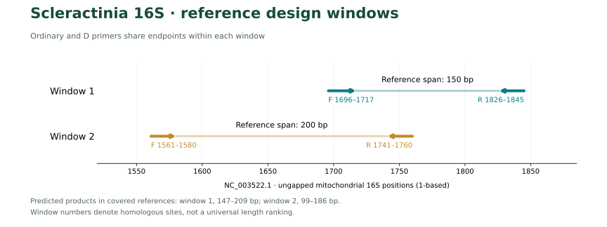
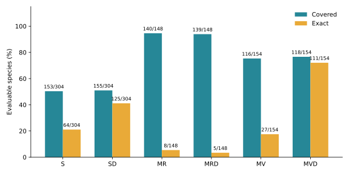
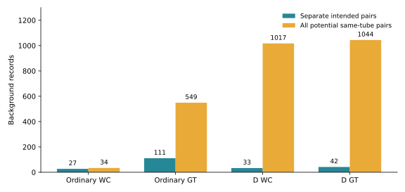

# MiScle: in silico design and evaluation of mitochondrial 16S rRNA primers for scleractinian coral eDNA metabarcoding

**Fei Xia**

Preprint v1.0 · 4 November 2026 · Not peer reviewed

## Abstract

MiScle compares homologous mitochondrial 16S windows S and M for scleractinian coral eDNA. S retains ordinary and D pairs. M now optimizes both F and R separately for Refertina and Vacatina, retaining MR, MV, MRD and MVD. R/V denote design emphasis; D denotes a degenerate pair. Corresponding ordinary/D endpoints are identical and degeneracy is ≤8 per oligo. Both suborders are targets, so cross-coverage is allowed.

This revision prioritizes Vacatina exact matching and reduced background hits. MVD alone exactly matches 111/154 Vacatina (72.08%), compared with 5/154 in the shared-F release and 75/154 for original MD. The two M-D assays used separately exactly match 128/304 species (42.11%), with 33/42 strict WC/GT background records, versus 103/111 previously. M-only coverage decreases from 284/304 to 281/304.

Adding unchanged SD as a separate assay gives 285/305 covered (93.44%) and 242/305 exact matches (79.34%). The lower-background Refertina D option was selected while preserving this cross-window union. Those results involve three separate PCR assays and do not replace the M-only statistics. **R/V assays are evaluated as separate PCRs followed by taxonomic aggregation; their union is not a same-tube multiplex result.**

**Keywords:** Scleractinia; environmental DNA; 16S rRNA; primer degeneracy; Refertina; Vacatina

## Introduction

Divergence at homologous 16S binding sites makes a shared forward primer a constraint on simultaneous exact matching and low background in the two suborders. MiFish provides an alignment, conserved-anchor and lineage-compensation design example (Miya et al., 2015), while Anth-28S-eDNA uses limited degeneracy supported by observed target variation (McCartin et al., 2024). These principles inform newly selected coral 16S candidates; the published MiFish and Anth28S sequences themselves are not used.

## Materials and methods

### References and homologous coordinates

Hisata et al. (2025) developed a **12S** system. Annotated mitochondrial 16S was extracted from eligible Table 1 records and supplemented with public Scleractinia references, including non-reef and deep-water taxa. Of 110 audited paper accessions, 65 contained eligible 16S and 45 did not; the latter are not amplification failures. The target query returned 1,974 records, and combined curation retained 879 eligible 16S records. One representative per source taxid and binomial species label was selected by gene completeness, length and low ambiguity, without selecting for primer compatibility.

The frozen panel contains 307 species labels, 131 genera and 29 source family labels: 148 Refertina, 157 Vacatina and two unassigned source lineages. Suborder interpretation follows WoRMS and Vaga et al. (2025); Guynia and Stenocyathus retain their unassigned source status. Family labels include older placements rather than asserting 29 currently accepted families. Only correctly oriented annotated 16S/mitochondrial large-subunit rRNA features were extracted; records shorter than 150 nt or with >5% ambiguity were excluded. MAFFT was used for alignment (Katoh & Standley, 2013).

Coordinates are 1-based positions in extracted, ungapped Acropora tenuis NC_003522.1 16S. S is F1696–1717/R1826–1845; M is F1561–1580/R1741–1760. The reference spans of 150 and 200 bp do not imply universal product lengths. Actual primer-inclusive ranges are recorded in [barcode and length statistics](../barcode_resolution.csv).

**Figure 1.** Fixed homologous binding windows on the extracted NC_003522.1 mitochondrial 16S reference. Coordinates are gene-relative, 1-based and inclusive.

### Independent F/R search and selection

At fixed M endpoints, separate F and R pools were generated for each suborder using independently verified binding templates and homologous columns of missed references. Ordinary candidates use A/C/G/T; D candidates iteratively merge observed homologous-column variation, with degeneracy ≤8 per oligo and no restriction to the 3′ half. Initial thermodynamic screening retained 32 Refertina F, 38 Vacatina F, 13 Refertina R and 39 Vacatina R candidates: 105 unique oligos, all scanned in both orientations and evaluated for paired orientation and spacing.

Background gates were WC≤50, GT≤120 and WC3≤800 records for Refertina, and WC≤10, GT≤20 and WC3≤100 for Vacatina. Among candidates within two species of the best suborder coverage, exact matching was prioritized, followed by coverage and background. The M-only optimal D pairs are retained as comparators. Among Refertina D options preserving both coverage and exact matching after adding fixed SD, selection minimized the higher background-model count, then considered Refertina exact matching and total background. The released MRD therefore trades some M-only matching for lower background without changing the cross-window union. This is a finite heuristic search using the same design reference library, without held-out or wet-laboratory validation.

### Internal homopolymers and thermodynamics

Internal mononucleotide repeats of up to five bases were allowed, while any concrete variant capable of six was excluded. This matches the Primer3 manual's default PRIMER_MAX_POLY_X=5; an allowed repeat is not evidence of experimental performance. Some MVD-R variants contain five T bases at positions 11–15, while the final three bases are TAC. These variants compensate a common Vacatina template and passed expanded-sequence thermodynamic and background checks.

Primer3 used 50 mM monovalent salt, 1.5 mM Mg²⁺ and 0.6 mM dNTP (Untergasser et al., 2012). Two scenarios were checked: 50 nM per concrete variant and 200 nM total per direction, corresponding to 25 nM per MVD variant in the latter. All concrete sequences within each pair were checked for hairpins, self-dimers and cross-dimers. Maximum structure Tm was <55°C and minimum duplex Tm ≥45°C; the F/R duplex-Tm midpoint difference was normally ≤5°C.

Ordinary MV additionally considered a ≤6°C branch, with a maximum predicted difference of 5.95°C. Losing two suborder-covered species increases exact matches from one under the ≤5°C branch to 27. MV therefore requires its own annealing-gradient comparison; a common optimum with other assays is not established. At 200 nM per direction, MVD's weakest variant has Tm 45.82°C and midpoint difference 4.89°C. Variant concentration and actual amplification efficiency require experimental assessment. Adapter-bearing full-length oligos and cross-suborder same-tube chemistry were not treated as passed validation.

### Coverage, background and independent checks

Coverage allows ≤2 mismatches per primer with IUPAC-compatible final three bases; exact matching requires zero mismatches at both ends. Both orientations are scanned. Target products are 70–500 bp with ≥20 internal bases; background internal distances are 0–1,000 bp. Strict WC uses Watson–Crick compatibility; GT computationally allows G–T pairing. WC3, GT2 and WC4 are relaxed sensitivity screens rather than laboratory detection probabilities.

The frozen background contains 9,145 records: 1,938 stratified cnidarian and 7,207 echinoderm references. Queries were capped; all marine biota, bacteria and symbiotic algae are not systematically represented. M has 304 evaluable species and three unknowns, and 305 are evaluable at S or M. Missing binding-window information is not a failure.

Independent exhaustive C++ and bit-parallel Python scans compare six released pairs plus 16 potential additional same-tube pairs, giving 132 target and strict-background coverage/exact set comparisons with zero disagreements. Extra pairs cover all self/cross pairings of four oligos, excluding the two intended F/R pairs. Released R/V metrics are unions of separate assays; same-tube sensitivity is reported independently.

## Results

### Matching within the intended taxon group

S rows use the whole target panel; M rows use their intended suborder. Background counts use all 9,145 non-target references. Whole-panel per-pair metrics are provided in [comparison.csv](../comparison.csv).

See Table 1.

**Figure 2.** Compatibility and exact paired matching within the intended evaluation group: all targets for S/SD, Refertina for MR/MRD and Vacatina for MV/MVD. Denominators differ between groups.

### M combinations and cross-window comparisons

See Table 2.

The M-D union exactly matches 117/154 Vacatina (75.97%), versus 12/154 in the shared-F release. MVD alone (111/154) and the two-assay union are distinct metrics. Refertina exact matching decreases; unchanged SD compensates many of those gaps, so not every individual assay improves on every metric.

With SD, the D scheme covers 285/305 and exactly matches 242/305, versus 285/305 and 160/305 for the shared-F release, and 279/305 and 206/305 for original SD+MD. M-only coverage and exact matching remain separately reported; cross-window gains require an extra PCR assay.

[Per species](../by_species.csv) · [Per suborder](../by_suborder.csv) · [Combined suborders](../combination_by_suborder.csv) · [Combinations](../two_pair_comparison.csv) · [Release comparisons](../release_comparison.csv) · [M-D misses](../missed_species.csv) · [Unevaluable species](../unknown_species.csv)

**Figure 3.** Background record counts for separate intended assays and all potential same-tube pairs. These are sequence-model predictions, not observed amplification rates.

### Background and reaction separation

The separate-assay D union has 33/42 WC/GT background records, both below the shared-F counts of 103/111; MVD alone has 0/2. Record-level hit counts cannot be converted to non-target read proportions in environmental samples. MRD retains substantial relaxed-model near-relative hits; see [background records](../background_hits.csv) and [per-pair metrics](../comparison.csv).

See Table 3.

Same-tube counts include all potential pairings rather than just the two intended F/R pairs. In particular, the Vacatina F–Refertina R combination expands the background. This release therefore uses separate suborder PCRs and aggregates classifications; same-tube multiplexing is not experimentally supported.

[Cross-pair background](../mixture_background_hits.csv) · [Same-tube sensitivity summary](../mixture_summary.csv)

### Base matching and barcode resolution

Figures group references by suborder and source family. F/R are shown 5′→3′, with R templates reverse-complemented. E denotes exact paired matching, C allowed-mismatch coverage, – no predicted hit and ? insufficient reference information. Blue is compatible, orange mismatch and grey gap/unknown; the final three bases are boxed. Covered rows use independently verified raw binding templates; other rows show homologous columns. R/V indicate design emphasis, not exclusive amplification of one suborder.

[Base data](../base_matching.csv) · [Verified templates and products](../verified_templates.csv) · [Barcode resolution](../barcode_resolution.csv) · [Shared barcodes](../shared_barcodes.csv)

Internal barcodes still show species-level and cross-genus sharing. These are observations within the current library, not identification-success estimates. Improved primer compatibility does not automatically improve internal-16S species resolution, and unlinked eDNA amplicons from different windows cannot be treated as phased haplotypes.

## Discussion

The principal gain from independent forward and reverse selection is improved exact compatibility in Vacatina. MVD exactly matches 111 of 154 evaluable Vacatina species, while the two M-D assays together exactly match 128 of 304 evaluable targets. The modest reduction in M-only coverage accompanies a reduction in strict background hits. This trade-off supports interpreting exact matching, coverage and background together rather than selecting on a single percentage.

The choice of MRD depends on the intended assay combination. Its lower-background branch preserves the union obtained with unchanged SD, but it is not the optimum for every M-only criterion. Adding SD yields 285 of 305 covered species and 242 exact matches. These gains require three separate assays and cannot be attributed to a single pair or to a validated multiplex reaction.

Reaction separation is a central design consequence. Allowing all potential pairings raises the D-scheme background from 33 to 1,017 WC records and from 42 to 1,044 GT records. Binding-site compatibility across the two lineage-specific oligo sets therefore creates a computational reason to retain separate PCRs. The models do not establish concentrations, annealing temperatures or competitive amplification efficiencies in environmental mixtures.

The library includes non-reef and deep-water taxa, but source taxonomic labels, incomplete windows and capped background queries shape the comparison. Species-level barcode sharing persists even where primer binding improves. One representative per species controls database redundancy without estimating population variation. The design and selection use the same frozen library; the independent implementation checks test calculation agreement rather than generalization to unseen taxa.

### Priorities for assay evaluation

| Intended comparison | Candidate | Rationale |
| --- | --- | --- |
| Vacatina exact compatibility | MVD versus original MD | 111/154 exact matches for MVD; assess bias and low-abundance detection |
| Reduced Refertina background | MRD with separate SD | Preserve the cross-window union while testing annealing optima |
| Lineage breadth | Separate MRD and MVD reactions | Avoid the predicted increase from unintended cross-pairs |
| Non-target susceptibility | Actiniaria and Corallimorpharia mixtures | Evaluate sequence-model hits in balanced and unbalanced templates |

## Conclusions

MiScle provides six fixed-coordinate 16S primer candidates across two homologous windows. Independent lineage-focused F/R selection improves Vacatina exact matching and reduces strict background counts, while SD complements the M-window assays. The released sequences, source references, barcode observations and independent scan checks provide a reproducible basis for evaluating separate coral eDNA assays.

## Data availability and reproducibility

Primer sequences, frozen reference inputs and analysis scripts are available at https://github.com/GUIBA-EX/MiScle. Run `python3 scripts/check_release.py` to check release consistency and `python3 scripts/verify.py` to repeat independent raw-sequence scans. Base-matching figures, per-species results and comparator releases are retained in the repository. The preprint source, PDF and publication checks are under `publications`.

## Computational assistance

OpenAI Codex assisted with code, manuscript organization and PDF production. Fei Xia is the named author.

## References

Hisata, K., Nagata, T., Kanai, M., et al. (2025). An eDNA metabarcoding system for detecting scleractinian corals to the generic level along the Japanese coast. *Galaxea, Journal of Coral Reef Studies*, 27, 13–29. https://doi.org/10.3755/galaxea.G27D-5
Miya, M., Sato, Y., Fukunaga, T., et al. (2015). MiFish, a set of universal PCR primers for metabarcoding environmental DNA from fishes: detection of more than 230 subtropical marine species. *Royal Society Open Science*, 2, 150088. https://doi.org/10.1098/rsos.150088
McCartin, L., Saso, E., Vohsen, S. A., et al. (2024). Nuclear eDNA metabarcoding primers for anthozoan coral biodiversity assessment. *PeerJ*, 12, e18607. https://doi.org/10.7717/peerj.18607
Katoh, K., & Standley, D. M. (2013). MAFFT multiple sequence alignment software version 7: improvements in performance and usability. *Molecular Biology and Evolution*, 30, 772–780. https://doi.org/10.1093/molbev/mst010
Untergasser, A., Cutcutache, I., Koressaar, T., et al. (2012). Primer3—new capabilities and interfaces. *Nucleic Acids Research*, 40, e115. https://doi.org/10.1093/nar/gks596
Vaga, C. F., Quattrini, A. M., Galvão de Lossio e Seiblitz, I., et al. (2025). A global coral phylogeny reveals resilience and vulnerability through deep time. *Nature*, 648, 377–382. https://doi.org/10.1038/s41586-025-09615-6
World List of Scleractinia. [Taxonomic classification](https://www.marinespecies.org/scleractinia/aphia.php?p=stats). Accessed 2026-10-30.
Primer3. [Manual: PRIMER_MAX_POLY_X](https://primer3.org/manual.html#PRIMER_MAX_POLY_X). Accessed 2026-10-30.

## Table 1. Target compatibility in the intended evaluation group

| Pair | Evaluation group | Evaluable | Covered | Exact | Background WC/GT |
|---|---|---:|---:|---:|---:|
| MiScle-S | All targets | 304 | 153 (50.33%) | 64 (21.05%) | 0 / 0 |
| MiScle-SD | All targets | 304 | 155 (50.99%) | 125 (41.12%) | 0 / 0 |
| MiScle-MR | Refertina | 148 | 140 (94.59%) | 8 (5.41%) | 27 / 111 |
| MiScle-MV | Vacatina | 154 | 116 (75.32%) | 27 (17.53%) | 0 / 0 |
| MiScle-MRD | Refertina | 148 | 139 (93.92%) | 5 (3.38%) | 33 / 40 |
| MiScle-MVD | Vacatina | 154 | 118 (76.62%) | 111 (72.08%) | 0 / 2 |

## Table 2. M-window separate-assay comparisons

| M scheme | Evaluable | Covered | Exact | Background WC/GT |
|---|---:|---:|---:|---:|
| Shared F ordinary | 304 | 282 (92.76%) | 78 (25.66%) | 103 / 111 |
| Shared F D | 304 | 284 (93.42%) | 98 (32.24%) | 103 / 111 |
| Independent F/R ordinary | 304 | 282 (92.76%) | 41 (13.49%) | 27 / 111 |
| Independent F/R D | 304 | 281 (92.43%) | 128 (42.11%) | 33 / 42 |

## Table 3. Background sensitivity to potential same-tube pairing

| Scheme | Model | Separate intended pairs | All potential same-tube pairs |
|---|---|---:|---:|
| ordinary | WC | 27 | 34 |
| ordinary | GT | 111 | 549 |
| D | WC | 33 | 1017 |
| D | GT | 42 | 1044 |

## Table 4. Released primer sequences

Sequences are 5′–3′ without adapters. All four M pairs share F1561–1580/R1741–1760; S and SD share F1696–1717/R1826–1845.

| Pair | Forward, 5′→3′ | Reverse, 5′→3′ | F/R degeneracy |
|---|---|---|---:|
| MiScle-S | `TTTGATAAGTGGGACAGTTTGG` | `TTAACGGGTCACTTAAACCC` | 1 / 1 |
| MiScle-SD | `YTKGATAAGTGRGACAGTTTGG` | `YYAACGGGTCACTTWAACCC` | 8 / 8 |
| MiScle-MR | `AAGTCCCCATGGAACTTTAC` | `CTTAAGTCCGCCTTCGTTAC` | 1 / 1 |
| MiScle-MV | `AAGTCCCCATGGAGCTTTAC` | `TCATAGTTCGTTTTCGTTAC` | 1 / 1 |
| MiScle-MRD | `AAGACCCCATGAAACTTTAC` | `CTTAAGYCCGCCTTCGTTAC` | 1 / 2 |
| MiScle-MVD | `AAGWCCCYATGGARCTTTAC` | `YCATAGTTCRTTTTYGTTAC` | 8 / 8 |
